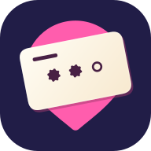
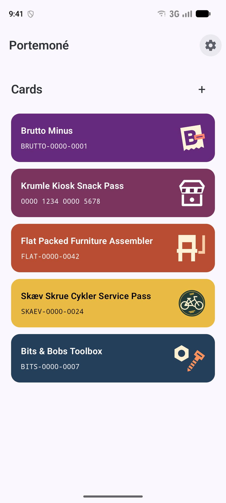
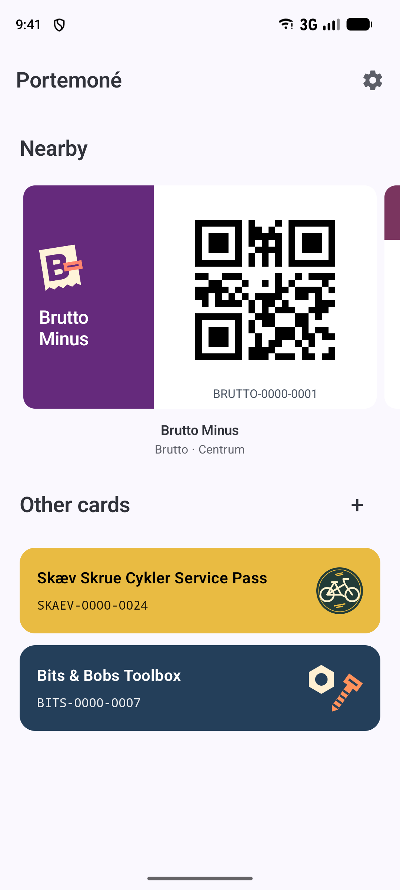
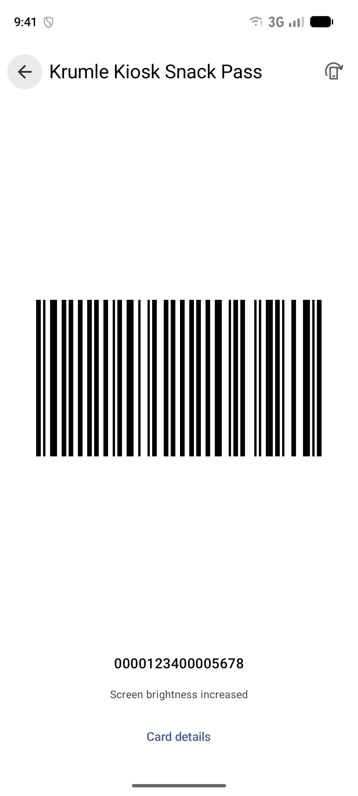
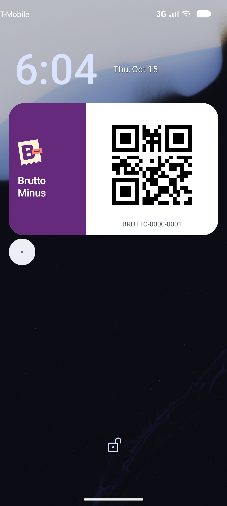

<!--
SPDX-FileCopyrightText: 2026 Sofie Finnes <sofie+git@finnes.dev>
SPDX-License-Identifier: EUPL-1.2
-->

  

<h1 align="center">Portemoné</h1>

Your loyalty card, ready when you reach the store.

An Android wallet for loyalty cards, with PKPass import, scannable codes,
home-screen widgets and nearby-card notifications. Requires Android 12+.

<table>
  <tr>
    <td>
      <picture>
        <source media="(prefers-color-scheme: dark)" srcset="docs/assets/screenshots/dark/wallet.png">
        
      </picture>
    </td>
    <td>
      <picture>
        <source media="(prefers-color-scheme: dark)" srcset="docs/assets/screenshots/dark/nearby-first.png">
        
      </picture>
    </td>
    <td>
      
    </td>
    <td>
      <picture>
        <source media="(prefers-color-scheme: dark)" srcset="docs/assets/screenshots/dark/lock-screen.png">
        
      </picture>
    </td>
  </tr>
</table>

## Features

- Stores are listed by distance, with the closest to you first.
- Save thousands of store locations. Android watches the ones near you for
  arrivals and departures. Portemoné updates the list as you travel.
- The right card shows up as a scannable notification when you reach a saved
  store, usually within minutes. Scan it from your lock screen at checkout.
  The notification goes away when you leave.
- Add cards yourself or import Apple Wallet passes. Choose how close you need
  to be for each store's card to appear. A home screen widget can show the
  nearby card's code, too.

## Tested devices

Full-card notifications show the card’s branding and scannable code. The optional `notification-companion` supports full-card
notifications across phone brands; tested devices and limitations are listed below.

| Device / system | Card appearance | Status |
| --- | --- | --- |
| Samsung Galaxy Z Fold4 / One UI 8.0 | Automatic (built-in) | Working |
| Google Pixel 8 (emulator) | Automatic (companion) | Working in emulator |
| Xiaomi / HyperOS 2 | Automatic (companion) | Visible border around the card |

Choose **Automatic** under **Settings → Notifications → Card appearance**.
Set up the companion there when needed; standard notifications provide a fallback.

## Card formats

Create cards with any of these barcode formats:

- Linear: Code 128, Code 39, Code 93, EAN-13, EAN-8, UPC-A, UPC-E,
  ITF, ITF-14 and Codabar.
- 2D: QR, PDF417, Aztec and Data Matrix.
- Plain: cards without a barcode.

Codes render locally. Membership values retain leading zeroes; EAN/UPC and
ITF-14 require complete values with valid check digits. Logo images can be
imported from files; camera and image-based barcode capture are not yet supported.

## Install

[Download Portemoné](https://github.com/soupglasses/portemone/releases/latest/download/portemone.apk) · [All releases](https://github.com/soupglasses/portemone/releases) · [Build from source](DEVELOPMENT.md#build).

For the optional Pixel/Xiaomi notification integration, also install the
[Notification Companion](https://github.com/soupglasses/portemone/releases/latest/download/portemone-notification-companion.apk). Samsung does not need it.

Obtainium setup

[Add to Obtainium](https://apps.obtainium.imranr.dev/redirect?r=obtainium%3A%2F%2Fapp%2F%257B%2522id%2522%253A%2522dev.finnes.portemone%2522%252C%2522url%2522%253A%2522https%253A%252F%252Fgithub.com%252Fsoupglasses%252Fportemone%2522%252C%2522author%2522%253A%2522soupglasses%2522%252C%2522name%2522%253A%2522Portemon%25C3%25A9%2522%252C%2522additionalSettings%2522%253A%2522%257B%255C%2522apkFilterRegEx%255C%2522%253A%255C%2522%255Eportemone%255C%255C%255C%255C.apk%2524%255C%2522%257D%2522%257D)

[Add Notification Companion to Obtainium](https://apps.obtainium.imranr.dev/redirect?r=obtainium%3A%2F%2Fapp%2F%257B%2522id%2522%253A%2522dev.finnes.portemone.notificationcompanion%2522%252C%2522url%2522%253A%2522https%253A%252F%252Fgithub.com%252Fsoupglasses%252Fportemone%2522%252C%2522author%2522%253A%2522soupglasses%2522%252C%2522name%2522%253A%2522Portemon%25C3%25A9%2520Notification%2520Companion%2522%252C%2522additionalSettings%2522%253A%2522%257B%255C%2522apkFilterRegEx%255C%2522%253A%255C%2522%255Eportemone-notification-companion%255C%255C%255C%255C.apk%2524%255C%2522%257D%2522%257D)

<!-- Publish the signed main APK as portemone.apk; the Obtainium link filters by that name. -->

## Development

See [DEVELOPMENT.md](DEVELOPMENT.md) for building, testing, signing and releases.

## Privacy and license

Portemoné stores your cards and matches nearby stores on your device. Maps load
from OpenStreetMap ([terms](https://osmfoundation.org/wiki/Terms_of_Use),
[privacy policy](https://osmfoundation.org/wiki/Privacy_Policy)). When you search
for an address, your phone may send the search to an outside service. Check
your phone's location-service privacy policy, such as [Google's](https://policies.google.com/privacy)
if you use Google services. Android backups may include your wallet data, and
lock-screen notifications can display card codes.

© 2026 Sofie Finnes. Original code is licensed under [EUPL 1.2](LICENSE).
The project logo and icons are [all rights reserved](LICENSES/LicenseRef-All-Rights-Reserved.txt).
See the [third-party notices](THIRD_PARTY_NOTICES.md) for other licenses.
